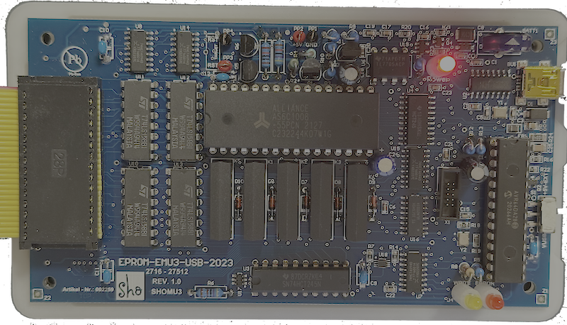

# Shogun

A tool that enables the use of the Shotech EPROM emulator with Linux and OSX.

<table>
<tr>
<td>
<pre>
 \.          ./    /
  `-._[##]_.-'    /
     .'|||`.     /
    /_|=  =|_\  /
  .---.\__/.---./
  |===|\  /|===|
  '---' \/ '---'
     |  (@)  |
    /|-//-|--|\
   / |//  |  | \
  '-&lt;&gt;----'--'-'
     |  |  |  |
     '--'  '--'
</pre>
</td>
<td>

</td>
</tr>
</table>


## Shotech

The German company [Shotech](https://www.shotech.de/) has an EPROM emulator called [SHOEMU3](https://www.shotech.de/de/shoemu3-eprom-emulator-2716-to-27512-bausatz.html). The device uses an Microchip AVR64DA28 chip, running on 14.7456MHz. It features a large SRAM of 128kByte, divided in two sections of 64kByte and emulates the 2716 up to the 27512. It also features a `RESET` and `nRESET` line that can be controlled from the host PC.

The SHOEMU3 is supported by [Windows software](https://www.shotech.de/Datasheet/shoemu3/EMU2-EMU3-WindowsSoftware-beta0_6.zip) only available from Shotech. The protocol and program source code are not available.

### Protocol

The protocol was derived from observing the communication between the SHOEMU3 and the windows software. The current firmware was `EMU3 version 01.04.00`.

The communications uses 115200 baud, 8N2. The SHOEMU3 device answers each character
with `<ACK>` `06` or `<NAK>` `15`. Numbers are sent as ASCII hex.

Load sequence: 
- `E`type
- `#`addr(8)
- `S`count(8)
- `W` + blocks of `LL`+data (≤0x85 bytes, one ACK per block)
- `&`crc(4)
- `V`
- `E`type
- `R`ms(4)
- `J`00000000.

The checksum is CRC16/ARC (polynome 0xA001, init 0).

## Tool Shogun

In order to use the SHOEMU3 with a computer running OSX or Linux a command line tool was created: `shogun.py`

This tool complements the Windows SHOEMU2 program. It is a single Python3 file with
no dependencies.

### Setup

```bash
chmod +x shogun.py
./shogun.py ports  # find the emulator's serial port
```

With Linux the port is usually something like `/dev/ttyUSB0` or `/dev/ttyACM0`. In case a "permission denied" is returned when running the program, it is required to add yourself (as user) to the `dialout` group, then log out and back in.

On MacOSX the port is usually something like `/dev/cu.usbserial-…` or `/dev/cu.usbmodem…`.

To set the port once add it using `export SHOGUN_PORT=/dev/ttyUSB0`.

### Usage

```bash
./shogun.py -p /dev/ttyUSB0 info                       # firmware version, clock, status
./shogun.py -p /dev/ttyUSB0 load diag.bin -t 27256     # 
./shogun.py load rom.hex -t 2764 --offset 0xE000       # HEX file linked at 0xE000
./shogun.py load rom.bin -t 27512 --fill               # fill unused space with 0xFF
./shogun.py reset --ms 200                             # pulse the target reset
./shogun.py bank 1 --reset                             # switch to the 2nd 64K image
./shogun.py stop | start
```

### Options for `load`

| Option           | Windows equivalent                                                |
|------------------|-------------------------------------------------------------------|
| `-t 2716…27512`  | EPROM Type                                                        |
| `--offset N`     | Offset Address: the file address that maps to EPROM address 0     |
| `--reset-ms 400` | Target Reset / Resettime                                          |
| `--no-reset`     | Target Reset / Resettime                                          |
| `--no-verify`    | turns off EMU2 Verify                                             |
| `--fill`         | Clear memory buffer (sends the full EPROM size, padded with 0xFF) |
| `--bank 0/1`     | Memory 0x0000…0xFFFF / 0x10000…0x1FFFF                            |
| `--no-start`     | load the image but leave emulation off                            |
| `--slow`         | char-by-char transfer, if block mode ever causes trouble          |
| `-v`             | show the raw protocol traffic                                     |

The tool reads binary, Intel HEX and Motorola S-record files.

### Sample Session

**Loading an image**

```bash
$ python3 shogun.py -p /dev/cu.usbserial-14630 load mon85-v12-ncb85\ copy.bin -t 27128
Emulator EMU3 firmware 01.03.00 on /dev/cu.usbserial-14630
File mon85-v12-ncb85 copy.bin (binary), EPROM 27128, address 0x0000-0x0FDB, 4060 bytes
  [########################################] 4060/4060 bytes
CRC16 59B9 ok
Verify ok
Emulation running, target reset 400 ms
Done in 1239 ms
```

**Verbose option**

```bash
python3 shogun.py -v -p /dev/cu.usbserial-14630 load mon85-v12-ncb85\ copy.bin -t 27128
  [dbg] send b'D'
Emulator EMU3 firmware 01.03.00 on /dev/cu.usbserial-14630
File mon85-v12-ncb85 copy.bin (binary), EPROM 27128, address 0x0000-0x0FDB, 4060 bytes
  [dbg] send b'E4'
  [dbg] send b'#00000000'
  [dbg] send b'S00000FDC'
  [dbg] send b'W'
  [dbg] send b'&59B9'
CRC16 59B9 ok
Verify ok
  [dbg] send b'E4'
  [dbg] send b'R0190'
  [dbg] send b'J00000000'
Emulation running, target reset 400 ms
Done in 1225 ms
```

**Help** 

```bash
python3 shogun.py -h
usage: shogun.py [-h] [-p PORT] [-v]
                 {ports,info,load,reset,bank,start,stop} ...

SHOGUN EPROM emulator tool for Linux and macOS

positional arguments:
  {ports,info,load,reset,bank,start,stop}
    ports               list likely serial ports
    info                show firmware version, clock and status
    load                load an image and start emulation
    reset               pulse the target reset line
    bank                switch 64K SRAM bank (for two images)
    start               start emulation with the data already in SRAM
    stop                stop emulation (disconnect from target)

options:
  -h, --help            show this help message and exit
  -p, --port PORT       serial port (or set SHOGUN_PORT)
  -v, --verbose

examples:
  shogun.py ports
  shogun.py -p /dev/ttyUSB0 info
  shogun.py -p /dev/ttyUSB0 load diag.bin -t 27256 --reset-ms 400
  shogun.py -p /dev/cu.usbserial-1410 load rom.hex -t 2764 --offset 0xE000
  shogun.py -p /dev/ttyUSB0 reset
```

# Disclaimer

Copyright (c)2026 by Roland van Straten.

License is [MIT](LICENSE).

Part of the software has been coengineerd by Claude AI.